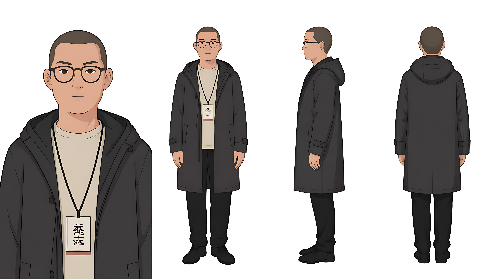

# C01 · 吴谓

## 简述

- **类型**：角色
- **首次出现**：第一集 场1 科技展入口
- **功能**：越界者，亲历异常，双能力者（空间转换/机器交流 + 数据转移/读取）

## 描述

25岁男性，科技有限公司员工，科技展参展者（非FX-7公司）。偏瘦中等身材，偏圆脸但下颌有棱角，短寸头，眉略压，眼神专注，常年戴一副细框眼镜。常态服装：深灰色中长连帽风衣（长度及胯）、素色T恤、深色长裤、胸前挂参展证。

## 能力设定

- **能力类型**：双能力——空间转换（机器拟人化+直接交流）、数据转移/读取。
- **触发条件**：必须处于异常影响范围内。离开异常范围，能力完全失效。
- **空间转换**：能把机器/设备看成一种拟人化的抽象形态，并与之直接交流。首次为第一集故障时被动触发（FX-7在他眼里“活”了过来）。主动使用需后续学习。代价：**按解决异常的数量累积**，吴谓本人会从所有人的记忆里逐层淡出；解决得越多，记得他的人越少。
- **数据转移**：可将已损坏或被删的数据原封不动转移到自己设备上。读到的数据分两种形态——**▮**（损坏）、**[数据删除]**/ **[/已编辑]**（被人为删除）。转移成功后数据以完整原貌出现，不带标记。
- **能力认知**：第一集时吴谓只知道“机器好像活了”和“想了想数据就过来了”，机制不明，后续逐步发现规律。
- **限制**：异常越强能力越明显；远离异常则完全失效；数据转移痕迹在FX-7公司检测设备上显示为无效符号▮。

## 代价总表

| 能力 | 代价 |
|---|---|
| 空间转换（机器交流） | 按解决异常数量累积，吴谓本人逐渐被所有人遗忘 |
| 数据转移 | 留下痕迹被检测（对方读不懂▮） |
| 修复异常（共同） | 渐进遗忘：修复一点，事件细节模糊一点；修复完成，事件从所有人记忆里清除，只有吴谓记得 |

## 证件照

> [此处插入角色正面证件照，白底或浅灰底，中性表情，用于跨镜一致性比对]



## 生成提示词

```text
2D国漫，柔和偏写实，平涂，干净细线条，低饱和，轻微噪点与纸张纹理，硬阴影局部，不安构图，不西化不日系，25岁男性，偏瘦中等身材，偏圆脸但下颌有棱角，短寸头，眉略压，眼神专注，细框眼镜，深灰色中长连帽风衣长度及胯，素色T恤，深色长裤，胸前挂参展证
负面词
暴漫粗黑线，夸张表情，审丑，日系柔光，西化五官，3D渲染，照片写实，高饱和荧光，长发，无眼镜，圆框眼镜，粗框眼镜
漂移警告
细框眼镜是核心辨识锚点，任何镜头不得省略。
短寸头，不是长发或碎发。
风衣是中长款（及胯），不是短夹克也不是长风衣。
参展证始终挂在胸前，不要省略。
表情始终克制，不要夸张化。