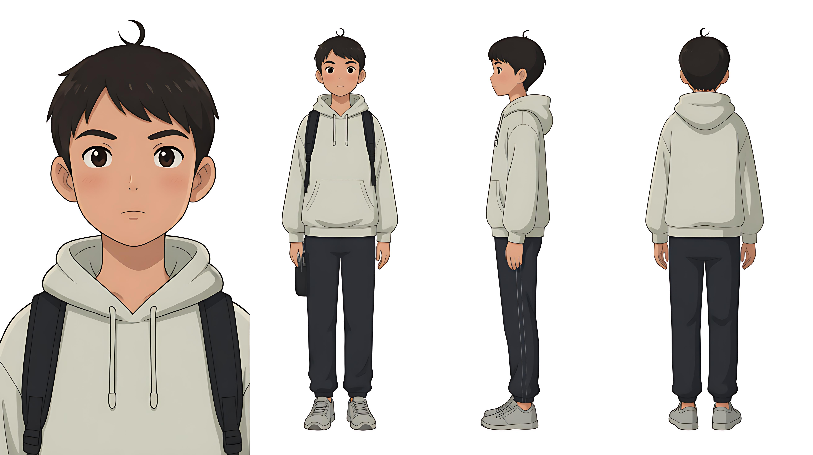

# C02 · 杜淼

## 简述

- **类型**：角色
- **首次出现**：第一集 场1 科技展入口
- **功能**：锚定者，记录现象，查资料，保留证据

## 描述

13岁男性，学生，科技爱好者。偏瘦小身材，圆脸，短发但有一撮翘起，眼睛偏大，眼神专注，不戴眼镜。常态服装：浅色连帽卫衣、深色运动裤、双肩包（侧袋插着一支笔），手持平板（背面贴满标签）。

## 功能设定

- **记录**：把看到的、查到的现象以字段形式记在平板里（异常名称、类型、现象、时间、位置）。限制：记录会被FX-7公司回收/删除，需手写备份。
- **查证**：查资料、比对信息、发现数据缺口。限制：13岁，权限和体力不足，查证速度慢，危险时容易慢半拍。
- **锚定**：给吴谓提供“人味”和外部记忆。吴谓被遗忘时，杜淼是唯一记得“吴谓做过什么”的人。限制：他自己也会被遗忘机制波及；记录被删则锚点断裂。
- **最怕**：出错（记错、漏记、判断错，导致吴谓或自己陷入危险）。
- **三条规则**：①先记再反应；②记录即证据；③不解释机制，只记现象。

## 证件照

> [此处插入角色正面证件照，白底或浅灰底，中性表情，用于跨镜一致性比对]



## 生成提示词

```text
2D国漫，柔和偏写实，平涂，干净细线条，低饱和，轻微噪点与纸张纹理，硬阴影局部，不安构图，不西化不日系，13岁男性少年，偏瘦小身材，圆脸，短发但有一撮翘起，眼睛偏大，眼神专注，不戴眼镜，浅色连帽卫衣，深色运动裤，双肩包侧袋插着一支笔，手持平板背面贴满标签
负面词
暴漫粗黑线，夸张表情，审丑，日系柔光，西化五官，3D渲染，照片写实，高饱和荧光，幼儿化，过度可爱，戴眼镜
漂移警告
短发但有一撮翘起，是核心辨识锚点，不要生成成整齐短发或长发。
不戴眼镜（与吴谓形成区分）。
双肩包侧袋的笔、平板背面的标签，两个锚点至少保留一个，不要省略。
年龄感是13岁少年，不要画成儿童或成年人。
平板始终在手中或随手可及处。